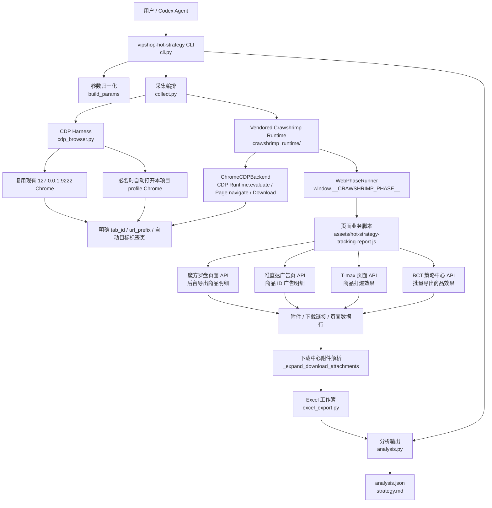
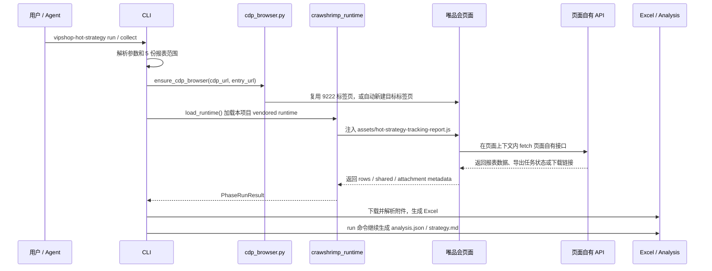

# 唯品会爆款策略追踪 Agent

这是一个独立的 CLI + skill 项目，用来把唯品会爆款策略复盘中常用的 5 份报表采集、导出、分析和策略总结固化成可重复执行的本地工具。

项目默认走只读链路：CLI 会优先复用用户已经登录的 Chrome CDP 9222 会话；如果 `127.0.0.1:9222` 不可用，会自动打开一个本项目专用 profile 的 9222 Chrome。采集仍然调用页面自己的报表接口读取数据，不读取或保存 cookie、token、localStorage、sessionStorage，也不修改广告、礼金、优惠券、预算、出价或商品配置。

## 合作交流与赞助

欢迎联系作者，交流唯品会运营报表采集、投放复盘与爆款策略分析，探讨报表自动化和项目合作，或赞助支持工具持续维护。

使用微信扫描下方二维码添加作者，备注「唯品会爆款策略 Agent + 合作 / 交流 / 赞助」。

<a href="https://crawshrimp.com/wechat-qr.jpg">
  
</a>

## 核心能力

| 命令 | 用途 | 输出 |
| --- | --- | --- |
| `collect` | 从 9222 浏览器只读采集 5 份报表 | Excel 工作簿 |
| `analyze` | 分析已有 Excel 工作簿 | `analysis.json`、`strategy.md` |
| `run` | 先采集再分析 | Excel、JSON、Markdown |
| `doc-summary` | 生成需求文档理解摘要 | Markdown |

当前覆盖 5 张报表：

- 魔方罗盘销售明细
- 唯直达投放效果
- T-max 商品打爆效果
- 中台礼金
- 中台购物车/跨品类券

## 架构与实现方式

项目分成三层：CLI 编排层、浏览器自动化运行层、报表业务脚本层。CLI 负责参数、输出和分析；浏览器运行层负责准备 9222 CDP Chrome、选择标签页和执行抓虾兼容 phase runtime；业务脚本在页面上下文里调用唯品会页面自己的接口，只读采集并把下载文件解析回 Excel。



真实采集是一条明确的只读流水线：



关键实现点：

- `src/vipshop_hot_strategy_agent/cli.py`：定义 `collect`、`analyze`、`run`、`doc-summary` 四个命令，把命令行参数转换为采集参数。
- `src/vipshop_hot_strategy_agent/cdp_browser.py`：默认先探测 `http://127.0.0.1:9222/json`；不可用时启动本地 Chrome，并使用 `~/.vipshop-hot-strategy-agent/chrome-cdp-profile` 作为隔离 profile。该模块只读 CDP target list，不读取 cookie、token 或浏览器 storage。
- `src/vipshop_hot_strategy_agent/collect.py`：连接 CDP、加载 vendored runtime、执行多 phase 页面脚本、保存下载中心文件并解析附件。
- `src/vipshop_hot_strategy_agent/crawshrimp_runtime/`：本项目内置的抓虾兼容运行时，包括 `ChromeCDPBackend`、`WebPhaseRunner`、`DownloadManager` 和协议结构，不再依赖外部 plugin 路径。
- `assets/hot-strategy-tracking-report.js`：报表业务逻辑。脚本在页面上下文里走 page-owned API：魔方后台商品明细导出、唯直达广告商品明细、T-max 商品打爆、BCT 右上角批量导出商品效果。
- `src/vipshop_hot_strategy_agent/excel_export.py` 和 `analysis.py`：把采集结果写入 workbook，并把 workbook 分析成 JSON 与中文策略 Markdown。

只读安全边界贯穿整条链路：CDP 只负责打开/选择标签页和执行页面上下文脚本；页面脚本只读取报表、提交报表导出任务、下载报表文件，不修改广告、预算、出价、礼金、优惠券或商品配置。

## 安装

```bash
cd /Users/xingyicheng/Documents/vipshop-hot-strategy-agent
python3 -m venv .venv
. .venv/bin/activate
python3 -m pip install -e .
```

依赖声明在本项目内维护：`pyproject.toml` / `requirements.txt` 包含 Excel、YAML 和 Chrome CDP WebSocket 运行依赖；抓虾兼容运行时已 vendored 到 `src/vipshop_hot_strategy_agent/crawshrimp_runtime/`，默认不再依赖外部 plugin 或 `/Documents/crawshrimp` 路径。

如果只想直接用源码运行，也可以：

```bash
PYTHONPATH=src python3 -m vipshop_hot_strategy_agent.cli --help
```

## 使用示例

分析已经导出的工作簿：

```bash
vipshop-hot-strategy analyze \
  /Users/xingyicheng/Downloads/唯品会爆款策略追踪报表_20260803-171542.xlsx \
  --out-dir /Users/xingyicheng/Downloads
```

重新采集并分析。默认会自动准备 9222 Chrome/CDP：能连上就复用现有会话，连不上就打开一个本项目专用 profile 的 Chrome。首次使用自动打开的 Chrome 时，需要在该浏览器里登录一次唯品会后台：

```bash
vipshop-hot-strategy run \
  --cdp-url http://127.0.0.1:9222 \
  --brand-keyword 巴拉巴拉 \
  --compass-start-date 2026-08-02 \
  --compass-end-date 2026-08-02 \
  --vipdirect-start-date 2026-08-02 \
  --vipdirect-end-date 2026-08-02 \
  --tmax-start-date 2026-08-02 \
  --tmax-end-date 2026-08-02 \
  --bct-gift-activity-start 2026-07-29 \
  --bct-gift-activity-end 2026-08-06 \
  --bct-scene-activity-start 2026-07-29 \
  --bct-scene-activity-end 2026-08-06 \
  --bct-product-export-type summary \
  --compass-export-wait-seconds 180 \
  --vipdirect-detail-source ad_list \
  --out-dir /Users/xingyicheng/Downloads
```

如果想指定已有标签页，可以传入 `--tab-id` 或 `--url-prefix`。如果想回到旧式严格模式，不自动打开 Chrome、不自动新建目标标签页，可以加 `--no-auto-cdp`：

```bash
vipshop-hot-strategy collect \
  --no-auto-cdp \
  --cdp-url http://127.0.0.1:9222 \
  --url-prefix https://compass.vip.com \
  --out-dir /Users/xingyicheng/Downloads
```

调试自动启动时可传：

- `--cdp-entry-url`：自动创建目标标签页时打开的 URL，默认按报表范围选择魔方/中台/唯直达/T-max 页面。
- `--chrome-path`：指定 Chrome/Chromium 可执行文件。
- `--chrome-profile-dir`：指定自动 CDP Chrome 的用户数据目录，默认 `~/.vipshop-hot-strategy-agent/chrome-cdp-profile`。

生成需求理解摘要：

```bash
vipshop-hot-strategy doc-summary --out-dir /Users/xingyicheng/Downloads
```

## 时间范围参数

5 张报表可以独立指定导出时间范围：

| 报表 | 参数 |
| --- | --- |
| 魔方罗盘销售明细 | `--compass-start-date` / `--compass-end-date` |
| 唯直达投放效果 | `--vipdirect-start-date` / `--vipdirect-end-date` |
| T-max 商品打爆效果 | `--tmax-start-date` / `--tmax-end-date` |
| 中台礼金 | `--bct-gift-activity-start` / `--bct-gift-activity-end` |
| 中台购物车/跨品类券 | `--bct-scene-activity-start` / `--bct-scene-activity-end` |

`--bct-activity-start` 和 `--bct-activity-end` 保留为礼金、购物车/跨品类券的共用 fallback。

魔方罗盘商品明细默认走页面同款后台导出链路：`/product/detail/asyncExportGoodsList` 提交任务，`/report/asyncdownload/queryTaskList` 查询下载中心，`/report/asyncdownload/getOutputFile` 自动下载文件，避开页面表格接口 `10000` 条上限；默认导出 `filter` 按商品明细页「自定义指标」全选口径生成，最终 `魔方罗盘销售明细` sheet 也按页面字段名和顺序输出。CLI 会在等待窗口内尝试下载并解析文件，只保留 `--brand-keyword` 指定的巴拉巴拉口径。后台导出失败时默认不再降级写入页面表格，避免把 `10000` 条上限内的数据误当完整明细；需要排查页面接口时可传 `--compass-table-api`，需要显式允许降级时传 `--compass-table-fallback`，需要严格失败时传 `--compass-export-required`。如果下载中心存在旧字段口径任务，CLI 会按当前 `filter` 校验并跳过；需要强制新建任务时传 `--compass-force-new-export`。

唯直达默认采集 `推广 > 站内广告 > 唯直达 > 广告` 页（`#/promotion/insite/search/advertisement`）的商品 ID 广告明细，而不是旧的报表汇总接口。需要回看旧汇总口径时可传 `--vipdirect-summary-api`；商品洞察口径必须提供 `--vipdirect-mid`。广告页接口异常时，只有提供 MID 才会降级到商品洞察的 MID x 广告明细接口，否则保留广告页接口错误，避免空 MID 请求返回 `1001` 掩盖真实问题。

中台礼金、购物车/跨品类券不再把策略效果页的活动列表当作商品明细写入 workbook。采集脚本会调用页面右上角「批量导出商品效果」同款下载中心配置：默认 `toolTaskMidSummary`（商品汇总效果数据），传 `--bct-product-export-type daily` 时使用 `toolTaskMidDaily`（商品每日新增效果数据明细）。如果下载中心文件在等待窗口内生成成功，CLI 会保存原始下载文件并把商品行解析进对应 sheet；如果页面只返回下载链接，CLI 会自动下载这个链接并解析，不需要用户再到下载中心手动点“下载”；若仍在生成中，sheet 会保留下载中心任务状态和筛选条件。

## 输出口径

`analysis.json` 保留机器可读指标，适合继续接 BI、周报或其他 agent。

`strategy.md` 面向运营复盘，包含：

- 数据覆盖和各 sheet 行数
- 商品曝光、点击、商详 UV、购买转化率、加购率
- 唯直达和 T-max 的曝光、点击、CTR、CPC、成交、ROI
- 礼金和购物车/跨品类券的使用销售额、使用人数、成本和 ROI 可算性
- 效果标签、置信度解释、保留/放大/观察/回滚/补数据建议

项目会严格区分 `0` 和缺失口径：只有页面接口明确返回数值 0 时才展示为 `0`；如果接口没有返回触达、订单、活动成本或 ROI 等字段，Markdown 会展示为 `未返回` 或 `不可算`，避免把空字段误判成业务无效果。

## 项目结构

```text
assets/                              5 报表页面采集脚本
docs/                                原始需求文档和提取后的需求文本
examples/                            CLI 参数示例
references/                          指标规则和安全边界
scripts/quick_validate.py            项目形态检查
skills/vipshop-hot-strategy-agent/   可安装或引用的 agent skill
src/vipshop_hot_strategy_agent/      CLI、CDP harness、采集、导出、分析代码
src/vipshop_hot_strategy_agent/crawshrimp_runtime/
                                     本项目 vendored 抓虾兼容运行时
tests/                               离线单元测试
```

## 验证

```bash
node --check assets/hot-strategy-tracking-report.js
PYTHONDONTWRITEBYTECODE=1 python3 -m unittest discover -s tests -v
PYTHONDONTWRITEBYTECODE=1 python3 scripts/quick_validate.py
```

真实采集验证会优先使用本机已有可用的 Chrome CDP 9222 登录态；如果没有，CLI 会打开一个 9222 Chrome。采集链路仍然只读，输出到本地目录。

## 当前边界

当前版本先把已经验证的 5 份报表打通成可复用 CLI。需求文档里的动作记录、产品基础信息、实验组/参考组、活动周期解析、触达/领取、毛利和售后质量，是下一阶段增强项；CLI 会在策略报告里明确这些数据缺口，避免把投放或权益带来的销售波动过度归因到单个运营动作。

## 安全说明

- 不提交、保存、发布、删除、付款、下单。
- 不批量修改营销活动、预算、出价、券、礼金、人群或商品配置。
- 不读取、打印、保存或转存 cookie、token、localStorage、sessionStorage、二维码、身份信息、支付信息。
- 公开仓库只包含采集和分析代码、需求说明、示例参数和测试，不包含真实导出结果或登录态。
